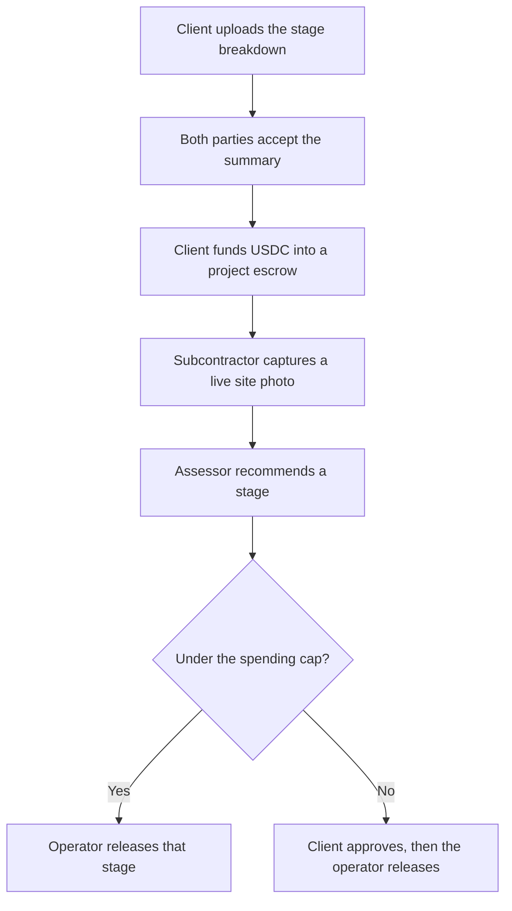

# Certa

[](https://github.com/Preciousbas/Certa/actions/workflows/ci.yml)

An AI site engineer on Telegram. Subcontractors photograph the work. Certa names the finished contract stage, and that stage's USDC leaves escrow after the client and the consultant have checked it.

Nigerian construction payments stall in disputes. Progress photos are easy to fake, and a stage that is actually done still waits on a cheque. Certa keeps the naira figures for people and the USDC for the chain, with one locked rate per contract.

## How it works



## Features

| Area | What ships in this repo |
| --- | --- |
| Escrow | `CertaEscrow` plus an EIP-1167 factory. Foundry unit, fuzz, and invariant tests. |
| Money | Kobo and 6-decimal USDC only. Display pairs show naira and USDC at the locked rate. |
| Tenancy | Workspaces, join codes, forced RLS, and `authorize()`. |
| Bot | `/start`, `/join`, `/switch`, `/project`, `/stages`, `/wallet`, `/report`. Webhook route and local polling. |
| Mini App | Timeline, stages, camera page, part-payment fund, changes, payment account, plan, cash-out stub, desk. |
| Documents | PDF, DOCX, XLSX, and CSV extraction into a Zod summary. Injection fixture does not move the sum. |
| Photos | Nonce, EXIF window, geofence, duplicate hash. Stamped copy with sharp is still to wire. |
| x402 | HTTP 402 weather and materials routes at $0.01 test USDC. |
| PDFs | Letterhead, payment lines, change log. Resend sends when `RESEND_API_KEY` is set. |

## Crypto integration

The chain is Ethereum Sepolia. Circle test USDC is `0x1c7D4B196Cb0C7B01d743Fbc6116a902379C7238`.

- One escrow clone per project. The factory and the rules are in `contracts/src`.
- Party payment accounts are Coinbase CDP server wallets when the three CDP env vars are set. Otherwise the address is a labelled mock, created once per party.
- Evidence for a submission is `keccak256` of the photo bundle and the assessment JSON. The contract stores that hash on `submitStage`.
- x402: `GET /api/paid/weather` and `GET /api/paid/materials-price` answer 402 with an exact-scheme challenge on `eip155:11155111`. Demo mode also accepts the header `x-payment: demo`.
- The 0.5% Certa fee is an off-chain ledger entry, not a cut inside `releaseStage`.

No factory address is listed in `docs/DEPLOYMENTS.md` until a broadcast. Do not treat the tests as a mainnet deployment.

## Experimentation log

| Tried | Result |
| --- | --- |
| pdf-parse 2.4.5 | The v2 API is a `PDFParse` class (`getText`, `destroy`), not a default function. CSV, DOCX, XLSX, and PDF fixtures parse in `packages/ai`. |
| Vision model | No `LLM_API_KEY` in this environment. `heuristicAssess` is the stand-in. Eval set: 20 labelled cases, 10 slab and 10 blockwork. Accuracy **80.0%**. Misses: slab-09, blk-06, blk-09, blk-10. Thresholds still hold: under 0.85 does not recommend a release. |
| `@x402/next` 2.28.0 | Not mounted. The CDP SDK's optional `@x402/*` imports are absent, and bundling that SDK broke `next build`. The shipped gate is the HTTP 402 body in `apps/web/lib/x402.ts`. |
| Inngest 4.23 | Cron triggers belong inside the options object. Hourly jobs call the same pure 72-hour and 7-day functions the unit tests use. |
| Foundry coverage | `CertaEscrow.sol` line coverage 96.46% (218/226) with `forge coverage --ir-minimum`. |
| CDP Paymaster, Slither, Playwright, Sentry | Not run. |

## Setup

```bash
pnpm install
bash scripts/setup-contracts.sh   # clones forge-std and OpenZeppelin into contracts/lib
cp .env.example .env
pnpm db:seed                      # optional; the demo also seeds an in-memory database
pnpm dev                          # Mini App on :3000. Does not start the Telegram poller.
pnpm dev:bot                      # local long polling; Ctrl-C puts the live webhook back
pnpm test                         # unit tests and forge test
```

`DEMO_MODE=1` uses PGlite when `DATABASE_URL` is empty, so the Mini App can show the Lekki duplex without Supabase. Set `DATABASE_URL` for Postgres. Apply `packages/db/migrations/0001_init.sql` there, then create the `certa_app` role the migration defines.

The bot answers `/start` on Vercel only after `TELEGRAM_BOT_TOKEN`, `TELEGRAM_WEBHOOK_SECRET`, and `TELEGRAM_BOT_USERNAME` are set on the project and the webhook points at `https://<host>/api/telegram`.

## Contract and bill of quantities

Send an Excel, CSV, Word, or PDF to `@CertaApp_bot`, or drop the same file on `/upload`. A bill is read only when it has item, description, quantity, rate, and amount columns. The code recomputes every row: quantity times rate must equal the amount, in kobo, with no floating point. Section totals become the stages, and those stage amounts must add up to the contract sum. A row that does not reconcile is listed in plain language, for example `25 x 12,000 should be 300,000 but the document says 30,000`, and the schedule is not accepted. Instructions hidden in the file are ignored and do not change the figures.

The person who uploads replies `accept`. The contractor joins with the code and sends `/accept`. Money stays locked until both of those are stored. The Lekki sample is not shown unless `DEMO_SEED=true`.

A photo of a paper bill is refused until it is sent as Excel or PDF. Old `.xls` files are read. HEIC photos are refused.

## How the AI decides

A stage photo is accepted only from the in-app camera. The server checks a 10-minute nonce, a capture time within 10 minutes, a GPS fix of 50 m or better, the site radius on the project (150 m unless the project says otherwise), a new sha256, a perceptual hash more than distance 6 from earlier photos, and a frame that is large enough and not dark or blurred. EXIF is recorded and not required, because the canvas JPEG does not carry it.

The live photo check is `stage_verify.v3`. The contractor claims a stage. The model answers that stage's checklist, each item yes, no, or cannot_see, and does not name the stage. Confidence is the yes answers divided by the checklist, computed in code. T stays **0.75**. A pass needs confidence at or above T, no item answered no, and the same pass on a second run. The two runs go out together. Each call still stops at 240 seconds. Photos are sent at 1024 px on the long side. A pass moves the stage to waiting for the consultant and calls `submitStage`. It does not release the money. A no with a clear reason fails the check. Too many items that cannot be seen ask for more photos.

On 22 Oct 2026, `gpt-6.1-sol` with `stage_verify.v3` was scored on 6 labelled site photos in `docs/eval/checklist-2026-10-22.md`. All 6 pairs parsed. 4 of 6 matched the label. There were 0 false passes. A call took about 78 seconds.

On 21 Oct 2026, `gpt-6.1-sol` with `stage_verify.v2` was scored on 20 labelled photos in `docs/eval/vision-2026-10-21-gpt-6.1-sol-20.md`. Sixteen replies parsed. The model predicted no passes. Every confidence sat between 0.50 and 0.74. It named the stage correctly 2 times out of those 16. Lowering T so those replies could pass would mostly let wrong answers through, so T stays **0.75**.

In the demo the model looks at the photos first, flags problems, and shows that confidence score. The consultant always makes the final call, with a written reason of at least 20 characters.

Photo checks are queued and processed by a GitHub Actions worker every ~10 minutes. GitHub can delay scheduled runs.

An earlier same-day call to `gpt-5.6-sol` parsed 0 of 88 replies, because the gateway had no channel for that model (`docs/eval/vision-2026-10-21-gpt-5.6-sol.md`). `deepseek-v4-flash` parsed 5 of 88, and none was a predicted pass (`docs/eval/vision-2026-10-21-deepseek.md`).

## Security model

See `docs/SECURITY.md`. Short version: no keys in the database, webhook secret on Telegram, HMAC on Mini App init data, RLS plus `authorize()`, idempotency keys on money, and an append-only hash-chained audit log.

Client, consultant, contractor, and operator each have their own Coinbase server wallet. Certa holds those wallets. The split is there so a bug or a single key cannot act as every role. A client approval is a verified Telegram tap, stored in `audit_log`, and the on-chain `clientApprove` is sent from that client's wallet. Connecting a person's own wallet is a later option. The operator policy is in `docs/spec/CDP_OPERATOR_POLICY.md`.

## Limits

- The escrow factory is on Ethereum Sepolia, and the source is verified on Etherscan.
- The active escrow is the pilot: 1 USDC mobilisation and 1 USDC per stage. The first quote is 2 USDC. The full Lekki escrow, whose first quote is 3,900 USDC, stays deployed for later.
- The camera page has no file picker. A photo is stamped in the corner and the original is kept. The check can move a stage to the consultant. It cannot release the money.
- Demo pages do not require Telegram `initData`.
- Cash out to a bank stops at "coming soon".
- Email verification before the first send is not built. Resend is skipped when the API key is empty.

## Roadmap

Mainnet USDC, CDP paymaster so users never buy gas, a live off-ramp, the chain indexer as the payment source of truth, and a priced plan per active project with the 0.5% release fee already sketched on the billing page.
