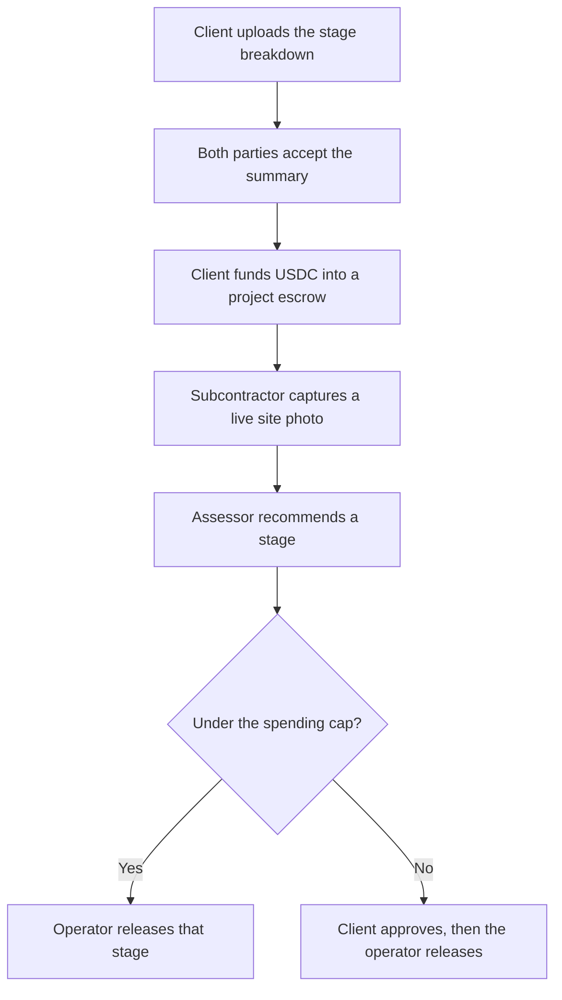

# Certa

An AI site engineer on Telegram. Subcontractors photograph the work. Certa names the finished contract stage, and that stage's USDC leaves escrow after the client and the consultant have checked it.

Nigerian construction payments stall in disputes. Progress photos are easy to fake, and a stage that is actually done still waits on a cheque. Certa keeps the naira figures for people and the USDC for the chain, with one locked rate per contract.

## How it works



## Features

| Area | What ships in this repo |
| --- | --- |
| Escrow | `CertaEscrow` plus an EIP-1167 factory. Foundry unit, fuzz, and invariant tests. |
| Money | Kobo and 6-decimal USDC only. Display pairs such as ₦45,000,000 (≈ 30,000.00 USDC @ ₦1,500). |
| Tenancy | Workspaces, join codes, forced RLS, and `authorize()`. |
| Bot | `/start`, `/join`, `/switch`, `/project`, `/stages`, `/wallet`, `/report`. Webhook route and local polling. |
| Mini App | Timeline, stages, camera page, part-payment fund, changes, payment account, plan, cash-out stub, desk. |
| Documents | PDF, DOCX, XLSX, and CSV extraction into a Zod summary. Injection fixture does not move the sum. |
| Photos | Nonce, EXIF window, geofence, duplicate hash. Stamped copy with sharp is still to wire. |
| x402 | HTTP 402 weather and materials routes at $0.01 test USDC. |
| PDFs | Letterhead, payment lines, change log. Resend sends when `RESEND_API_KEY` is set. |

## Crypto integration

The chain is Base Sepolia. Circle test USDC is `0x036CbD53842c5426634e7929541eC2318f3dCF7e`.

- One escrow clone per project. The factory and the rules are in `contracts/src`.
- Party payment accounts are Coinbase CDP server wallets when the three CDP env vars are set. Otherwise the address is a labelled mock, created once per party.
- Evidence for a submission is `keccak256` of the photo bundle and the assessment JSON. The contract stores that hash on `submitStage`.
- x402: `GET /api/paid/weather` and `GET /api/paid/materials-price` answer 402 with an exact-scheme challenge on `eip155:84532`. Demo mode also accepts the header `x-payment: demo`.
- The 0.5% Certa fee is an off-chain ledger entry, not a cut inside `releaseStage`.

No factory address is listed in `docs/DEPLOYMENTS.md` until a broadcast. Do not treat the tests as a mainnet deployment.

## Experimentation log

| Tried | Result |
| --- | --- |
| pdf-parse 2.4.5 | The v2 API is a `PDFParse` class (`getText`, `destroy`), not a default function. CSV, DOCX, XLSX, and PDF fixtures parse in `packages/ai`. |
| Vision model | No `LLM_API_KEY` in this environment. `heuristicAssess` is the stand-in. Eval set: 20 labelled cases, 10 slab and 10 blockwork. Accuracy **80.0%**. Misses: slab-09, blk-06, blk-09, blk-10. Thresholds still hold: under 0.85 does not recommend a release. |
| `@x402/next` 2.28.0 | Not mounted. The CDP SDK's optional `@x402/*` imports are absent, and bundling that SDK broke `next build`. The shipped gate is the HTTP 402 body in `apps/web/lib/x402.ts`. |
| Inngest 4.23 | Cron triggers belong inside the options object. Hourly jobs call the same pure 72-hour and 7-day functions the unit tests use. |
| Foundry coverage | `CertaEscrow.sol` line coverage 96.46% (218/226) with `forge coverage --ir-minimum`. |
| CDP Paymaster, Slither, Playwright, Sentry | Not run. |

## Setup

```bash
pnpm install
bash scripts/setup-contracts.sh   # clones forge-std and OpenZeppelin into contracts/lib
cp .env.example .env
pnpm db:seed                      # optional; the demo also seeds an in-memory database
pnpm dev                          # Mini App on :3000, bot polls only if TELEGRAM_BOT_TOKEN is set
pnpm test                         # unit tests and forge test
```

`DEMO_MODE=1` uses PGlite when `DATABASE_URL` is empty, so the Mini App can show the Lekki duplex without Supabase. Set `DATABASE_URL` for Postgres. Apply `packages/db/migrations/0001_init.sql` there, then create the `certa_app` role the migration defines.

The bot answers `/start` on Vercel only after `TELEGRAM_BOT_TOKEN`, `TELEGRAM_WEBHOOK_SECRET`, and `TELEGRAM_BOT_USERNAME` are set on the project and the webhook points at `https://<host>/api/telegram`.

## Security model

See `docs/SECURITY.md`. Short version: no keys in the database, webhook secret on Telegram, HMAC on Mini App init data, RLS plus `authorize()`, idempotency keys on money, and an append-only hash-chained audit log.

## Limits

- The escrow has not been broadcast or verified on Basescan.
- Demo funding writes a payment row. It does not send `fund`.
- The camera page has no file picker. Sharp stamping and a real EXIF parser are not connected to the capture route yet.
- Demo pages do not require Telegram `initData`.
- Cash out to a bank stops at "coming soon".
- Email verification before the first send is not built. Resend is skipped when the API key is empty.

## Roadmap

Mainnet USDC, CDP paymaster so users never buy gas, a live off-ramp, the chain indexer as the payment source of truth, and a priced plan per active project with the 0.5% release fee already sketched on the billing page.
