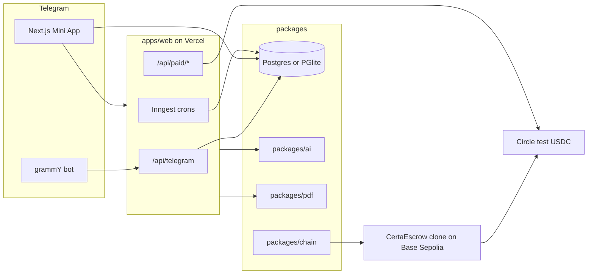
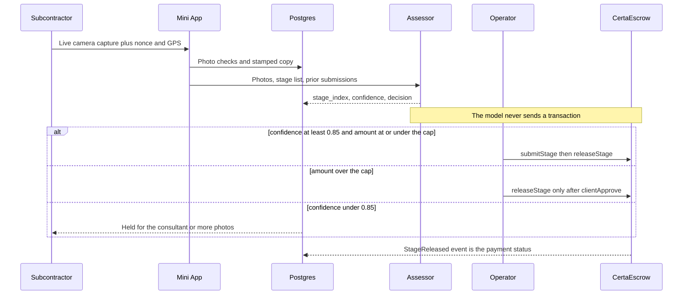
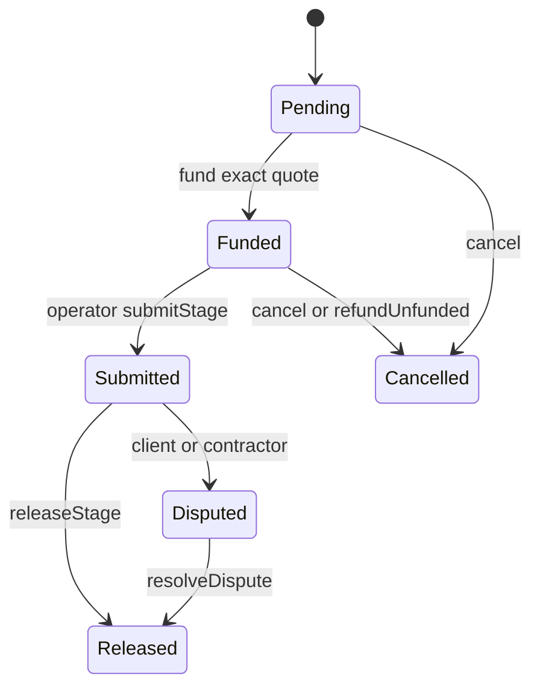

# Architecture

Certa is a Telegram site engineer. A subcontractor photographs the work. The app checks the photo, an assessor recommends a contract stage, and USDC moves out of that project's escrow only after the checks in the contract pass.

## System

Money is stored as integers. Naira is kobo. USDC is 6-decimal base units. The locked rate lives on the project. The contract only sees USDC.

## Submit, assess, release

The indexer that reconciles those events is specified and not running yet. Payment rows are written with a unique idempotency key. A demo fund records the row without broadcasting a transaction.

## Contract state machine

Each stage starts `Pending`. `fund` moves the quoted stages to `Funded`. `submitStage` moves one to `Submitted` and stores the evidence hash. `releaseStage` pays `amount - retention` to the contractor and leaves the stage `Released`. `dispute` locks a submitted stage. `resolveDispute` splits that stage by basis points. `cancel` refunds funded stages that are not submitted or disputed.

`releaseStage` reverts unless the stage is `Submitted`, the project is not paused, and an above-cap stage has `clientApproved`. A failed inspection leaves the USDC locked.

## Tenancy

Every tenant table carries `workspace_id`. Requests set `app.current_user_id` and `app.current_workspace_id`, then `SET LOCAL ROLE certa_app`. Row level security is forced for that role. `authorize()` in `packages/db` is the application gate and runs even when the database role could bypass RLS. A subcontractor sees their own stages. A main contractor sees subcontractors only when `can_view_subs` is set.
